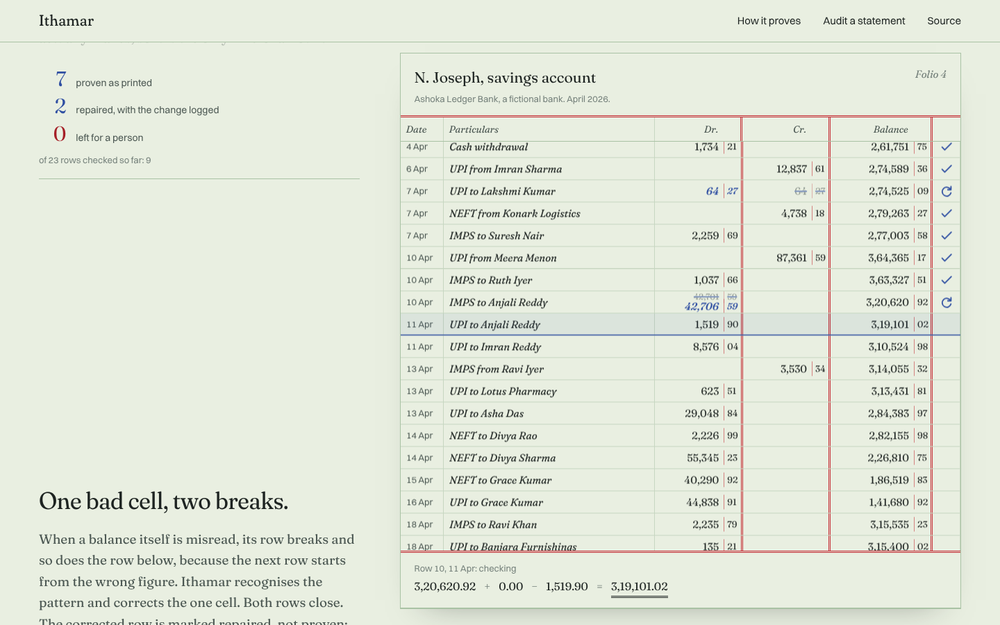

# Ithamar

**Indian bank statements, extracted and proven row by row against their own running balance.**


Every bank statement carries its own proof. Each row obeys one line of arithmetic:

```
balance above + credit - debit = balance printed
```

Ithamar reads a statement PDF, walks that equation down the page, and marks each row as one of:

| Mark | Meaning |
|---|---|
| ✓ proven | the arithmetic holds exactly as printed |
| ↻ repaired | it holds after one correction, and the correction is logged beside the row |
| ✗ left for you | no correction is earned; Ithamar says what it found and stops |

It never guesses, and it never invents a transaction.

**Try it in the browser:** the site parses and proves a PDF entirely inside your tab. Nothing is uploaded; there is no server.



## How it works

1. **Layout parsing without templates.** `parse/layout.py` finds the header row, learns each column's position from its header words, then assigns every word below it by geometry: amounts align to a column's right edge, text to its left. Lines without a date continue the row above. It handles lakh grouping (`1,00,000.00`), `Dr`/`Cr` suffixes, single amount columns with a direction column, wrapped narrations, and headers repeated on every page.
2. **The balance chain.** `verify/chain.py` walks the equation. When a row fails, the chain resyncs on the printed balance, so one bad cell makes one or two breaks instead of corrupting everything below it.
3. **Naming the break.** Each break is tested against four concrete explanations, each with the exact correction it implies:
   - the amount is in the wrong column
   - a digit in the amount was misread (one substitution, drop, insertion or adjacent swap, or a decimal shift)
   - a digit in the balance was misread (its row breaks, and so does the row below)
   - a whole row is missing
4. **Repair is a decision, not a guess.** `verify/repair.py` applies a correction only when:
   - it is the only specific explanation that closes the local window: the broken row *and* the next row that prints a balance must both agree afterwards
   - it strictly reduces the number of breaks

   A missing row is **never** applied, because it explains any break and so proves nothing. Rows the engine corrects end as `repaired`, never `verified`; proven after a change is a different claim from proven as printed.
5. **Narration decoding.** `narration/decode.py` pulls out the rail (UPI, NEFT, IMPS, RTGS, ACH, cheque, card, ATM, charges, interest), VPA, 12-digit RRN, UTR, IFSC and a best-effort counterparty. None of this is proven by the chain, and the output says so.

All money is integer paise. Floats never touch an amount.

### What the chain proves, and what it does not

| Proven by arithmetic | Not proven |
|---|---|
| Debit, credit and balance of every verified row | Dates |
| No transaction is missing between two verified rows | Narration text and counterparty names |
| The closing balance matches the last row | Rows on statements that print no running balance (marked `unchecked`) |

## Results

`ithamar bench` renders statements whose truth is known by construction. The benchmark covers three layouts, wrapped narrations, page breaks, repeated headers and `Dr`/`Cr` suffixes. It injects extraction-style errors into what is printed, never into the truth, then scores the engine.

```
24 statements, 855 rows, 39 injected errors
every swap, amount misread and balance misread repaired to its true value
every missing row flagged and left alone
false-verified rows across 24 statements: 0
```

The headline metric is **false-verified rows**: rows marked proven that are actually wrong. It must stay at zero.

These are synthetic statements made by this project's own generator. They show the verifier works. They do not show that the parser handles every real bank. Real statements are the next test, and the results will be published the same way, failures included.

## Install and run

```bash
pip install git+https://github.com/victorisaacchinta-eng/ithamar

ithamar audit statement.pdf --password ****** --json audit.json --csv rows.csv
ithamar demo                          # generate synthetic statements and audit them
ithamar bench samples/ --generate 24  # score the engine against known truth
```

`ithamar audit` exits `0` when every row is proven, `1` when rows were repaired, and `2` when a person needs to look, so it can gate a script.

### Development

```bash
pip install -e ".[dev]"
pytest                       # 63 tests, including property tests (hypothesis)

cd web && npm install
npm run dev                  # the site
npm run parity               # the TypeScript engine must agree with Python, row for row
```

## Two engines, one behaviour

The command line runs the Python engine on `pdfplumber`. The website runs a TypeScript port (`web/src/engine/`) on `pdf.js`, so a statement can be audited without leaving the browser. `web/scripts/parity.ts` runs both on the same PDFs and fails on any difference in rows, amounts, statuses, repairs, unresolved rows or decoded narration fields. CI runs it on every push.

## Tests

- `tests/test_chain.py`: property tests. A clean ledger always verifies, and any single swap, amount change, balance change or deleted row is always caught, across hundreds of generated ledgers.
- `tests/test_repair.py`: the repair contract. The headline property is that whatever single error is injected, no row is ever marked verified or repaired unless its values equal the truth.
- `tests/test_end_to_end.py`: render PDFs in all three layouts, parse them back, demand exact amounts, balances and narrations, and check that every injected error is caught.
- `tests/test_parsing.py`: Indian amounts, day-first dates, header classification, narration decoding.

## Not yet

- Scanned statements. They need OCR, gated by the same chain.
- Real statements from specific banks, kept private and used only as parser regression tests.
- Local-model repair for breaks no rule explains. The model's answer would be just another hypothesis, and it must make the chain close.
- Reconciliation against a Tally ledger export.

## Privacy

Ithamar makes no network calls. Never commit a real statement: keep it in `private/`, which `.gitignore` excludes. Every bank, person and transaction in this repository is fictional.

## Why the name

> This is the sum of the tabernacle, even of the tabernacle of testimony, as it was counted, according to the commandment of Moses, for the service of the Levites, by the hand of Ithamar, son to Aaron the priest.
> Exodus 38:21 (KJV)

The first audit on record was kept by Ithamar, and its silver can still be checked. Exodus 38:25 to 26 counts 603,550 men giving half a shekel each, which is 301,775 shekels. It separately reports the total as 100 talents and 1,775 shekels, which at 3,000 shekels to the talent is also 301,775. Two independent records, one total.

## Licence

MIT. Copyright (c) 2026 Chintha Victor Isaac.
