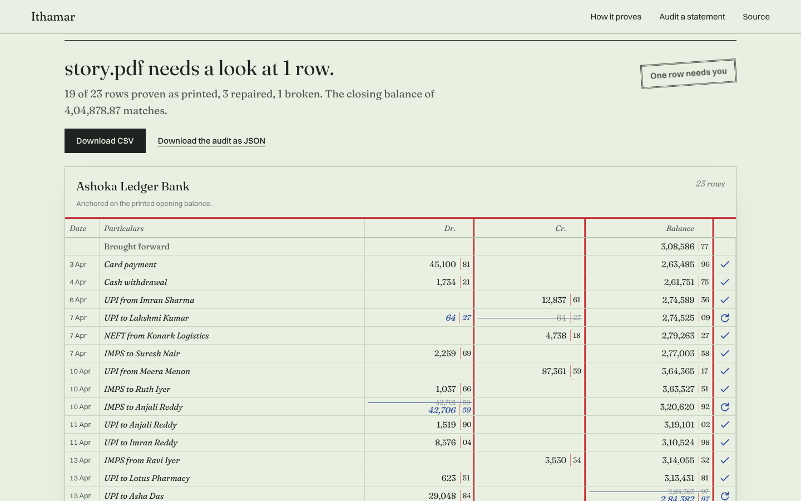

# Ithamar

Ithamar extracts transactions from Indian bank statement PDFs and checks every row against the statement's own running balance.


Every bank statement already carries a check. Each row has to satisfy:

```
balance above + credit - debit = balance printed
```

Ithamar reads the PDF, walks that equation down the page and marks each row as one of three things:

- **✓ proven**: the arithmetic holds exactly as printed
- **↻ repaired**: it holds after one correction, and the correction is logged beside the row
- **✗ left for you**: no correction is justified, so Ithamar says what it found and stops

You can try it at [ithamar.vercel.app](https://ithamar.vercel.app). The site parses and checks the PDF inside your browser tab; nothing is uploaded and there is no server. Each audited statement also gets a seal, a cheque-style guilloche rosette drawn from its balances: repaired rows show in violet, and a row that does not balance slips out of line in magenta.




## How it works

1. **Layout parsing, no templates.** `parse/layout.py` finds the header row, learns where each column sits from its header words, then assigns every word below it by position: amounts align to a column's right edge, text to its left. It handles lakh grouping (`1,00,000.00`), `Dr`/`Cr` suffixes, single amount columns with a direction column, wrapped narrations, and headers repeated on every page.
2. **The balance chain.** `verify/chain.py` walks the equation. When a row fails, the chain resyncs on the printed balance, so one bad cell makes one or two breaks instead of corrupting everything below it.
3. **Explaining a break.** Each break is tested against four explanations, each with the exact correction it implies: the amount is in the wrong column; a digit in the amount was misread (one substitution, drop, insertion or adjacent swap, or a decimal shift); a digit in the balance was misread (its row breaks, and so does the row below); or a whole row is missing.
4. **Repair.** `verify/repair.py` applies a correction only when it is the only specific explanation that closes the local window (the broken row and the next row that prints a balance must both agree afterwards) and it strictly reduces the number of breaks. A missing row is not applied automatically, because it can explain any break and so proves nothing. Rows the engine corrects end as `repaired`, not `verified`, since "correct after a change" is a different claim from "correct as printed".
5. **Narration decoding.** `narration/decode.py` pulls out the rail (UPI, NEFT, IMPS, RTGS, ACH, cheque, card, ATM, charges, interest), VPA, 12-digit RRN, UTR, IFSC and a best-effort counterparty. None of this is checked by the chain, and the output says so.

All money is stored as integer paise. Floats never touch an amount.

The chain proves the debit, credit and balance of every verified row, that no transaction is missing between two verified rows, and that the closing balance matches the last row. It does not prove dates, narration text or counterparty names, or anything on statements that print no running balance (those rows are marked `unchecked`).

## Results

`ithamar bench` renders statements whose truth is known by construction. They cover three layouts, wrapped narrations, page breaks, repeated headers and `Dr`/`Cr` suffixes. The benchmark injects extraction-style errors into what is printed, not into the truth, then scores the engine.

```
24 statements, 855 rows, 39 injected errors
every swap, amount misread and balance misread repaired to its true value
every missing row flagged and left alone
false-verified rows across 24 statements: 0
```

The number I care about is false-verified rows: rows marked proven that are actually wrong. It has to stay at zero.

These are synthetic statements from the project's own generator. They show the verifier works; they don't show that the parser handles every real bank. Real statements are the next test, and I'll publish those results the same way, failures included.

## Install and run

```bash
pip install git+https://github.com/victorisaacchinta-eng/ithamar

ithamar audit statement.pdf --password ****** --json audit.json --csv rows.csv
ithamar demo                          # generate synthetic statements and audit them
ithamar bench samples/ --generate 24  # score the engine against known truth
```

`ithamar audit` exits `0` when every row is proven, `1` when rows were repaired, and `2` when a person needs to look, so it can gate a script.

For development:

```bash
pip install -e ".[dev]"
pytest                       # 63 tests, including property tests (hypothesis)

cd web && npm install
npm run dev                  # the site
npm run parity               # the TypeScript engine must agree with Python, row for row
```

The command line runs the Python engine on `pdfplumber`. The website runs a TypeScript port (`web/src/engine/`) on `pdf.js`. `web/scripts/parity.ts` runs both on the same PDFs and fails on any difference in rows, amounts, statuses, repairs, unresolved rows or decoded narration fields; CI runs it on every push.

The property tests in `tests/test_chain.py` check that a clean ledger always verifies and that any single swap, amount change, balance change or deleted row is caught, across hundreds of generated ledgers. `tests/test_repair.py` checks that whatever single error is injected, no row is marked verified or repaired unless its values equal the truth. `tests/test_end_to_end.py` renders PDFs in all three layouts and parses them back, and `tests/test_parsing.py` covers amounts, dates, headers and narrations.

## Not yet

- Scanned statements. They need OCR, checked by the same chain.
- Real statements from specific banks, kept private and used only as parser regression tests.
- Local-model repair for breaks no rule explains. The model's answer would be just another hypothesis, and it would still have to make the chain close.
- Reconciliation against a Tally ledger export.

## Privacy

Ithamar makes no network calls. Don't commit a real statement: keep it in `private/`, which `.gitignore` excludes. Every bank, person and transaction in this repository is fictional.

## The name

> This is the sum of the tabernacle, even of the tabernacle of testimony, as it was counted, according to the commandment of Moses, for the service of the Levites, by the hand of Ithamar, son to Aaron the priest.
> Exodus 38:21 (KJV)

The first audit on record was kept by Ithamar, and its silver can still be checked. Exodus 38:25 to 26 counts 603,550 men giving half a shekel each, which is 301,775 shekels. It separately gives the total as 100 talents and 1,775 shekels, which at 3,000 shekels to the talent is also 301,775.

## Licence

MIT. Copyright (c) 2026 Chintha Victor Isaac.
